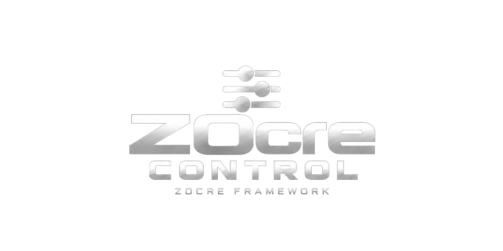

# ZOcre Control

  

**L’application Windows x64 dédiée au déploiement et à la gestion des serveurs nanos world et de l’écosystème ZOcre.**

[Télécharger ZOcre Control](https://github.com/zocre-framework-official/zocre-control/releases/latest) · [Discord officiel](https://discord.gg/Ey4dn4Cbqj) · [Support](docs/SUPPORT.md) · [Sécurité](docs/SECURITY.md) · [Ko-fi](https://ko-fi.com/ncoreframework)

## Français

ZOcre Control rassemble le déploiement de serveurs nanos world standards et la gestion de plusieurs instances indépendantes dans une interface en français et en anglais.

### Déploiement et gestion des serveurs

- Installer un serveur **nanos world standard**.
- Sélectionner et gérer plusieurs serveurs indépendants ; démarrer, arrêter ou redémarrer le serveur sélectionné.
- Consulter sa console et ouvrir son dossier depuis les actions serveur.
- Utiliser les sauvegardes et l’importation de serveurs compatibles, avec les contrôles de destination et de conservation affichés.
- Rechercher les mises à jour du serveur nanos world et de ZOcre Control ; les opérations serveur indiquent lorsqu’un arrêt est nécessaire.
- Signaler un bug avec un message, des diagnostics préparés automatiquement et jusqu’à cinq pièces jointes facultatives.

### Écosystème ZOcre et intégrations

ZOcre Control est conçu pour réunir le déploiement de serveurs nanos world standards, l’intégration de ZOcre Framework et la gestion de plusieurs instances indépendantes dans une interface centralisée.

Son périmètre de conception comprend également la maintenance des kits de développement nanos world (DK), des scripts, des packages et des composants pris en charge dans l’écosystème ZOcre.

La disponibilité des intégrations et des opérations est précisée dans les [notes de version](https://github.com/zocre-framework-official/zocre-control/releases/latest).

### Installer l’application

1. Téléchargez le **Setup de ZOcre Control** depuis la [release officielle](https://github.com/zocre-framework-official/zocre-control/releases/latest) et comparez son [empreinte SHA-256](docs/CHECKSUMS.txt) à celle publiée.
2. Lancez le Setup, choisissez le dossier de l’application et associez votre compte Discord.
3. Le rôle Membre du Discord officiel est requis. Lisez la licence et acceptez-la si vous êtes d’accord, puis suivez la progression de l’installation.

Choisissez ensuite un dossier distinct pour chaque serveur. L’application vérifie la destination avant de commencer une nouvelle installation.

### Compte Discord et accès

Après la première association, votre compte reste associé au profil Windows. L’appartenance au Discord officiel et le rôle requis sont revérifiés automatiquement pour les opérations protégées. Une perte du rôle, un départ ou un bannissement empêche un nouvel accès protégé.

Les serveurs nanos world déjà installés et leurs fichiers restent utilisables indépendamment de ZOcre Control. Le fonctionnement du serveur nanos world standard ne dépend pas de votre association Discord à l’application.

### Désinstallation et réinstallation

Désinstallez **ZOcre Control** depuis les applications Windows. Les serveurs, leur catalogue et vos réglages sont conservés ; le compte Discord est déconnecté. Lors d’une réinstallation, refaites simplement l’association Discord. Les serveurs conservés peuvent réapparaître dans la gestion ; utilisez l’importation compatible si vous devez les rattacher de nouveau.

### Signaler un problème

Cliquez sur **Signaler un bug**, décrivez le problème, sélectionnez éventuellement vos fichiers, puis cliquez une fois sur **Envoyer le rapport**. L’envoi est volontaire et arrive au support privé. Consultez [SUPPORT.md](docs/SUPPORT.md) avant de joindre des fichiers.

## English

ZOcre Control is a Windows x64 application for deploying standard nanos world servers and managing independent instances, with French and English interfaces.

Server operations include start, stop and restart, console access, opening the selected server folder, compatible backup and import operations, server and application updates, and voluntary private bug reports with optional attachments.

### ZOcre ecosystem and integrations

ZOcre Control is designed to bring together standard nanos world server deployment, ZOcre Framework integration and independent server management in one application. Its design scope also covers centralized maintenance of nanos world development kits (DKs), scripts, packages and supported components in the ZOcre ecosystem.

Integration and operation availability is detailed in the [release notes](https://github.com/zocre-framework-official/zocre-control/releases/latest).

### Installation and access

Download the **ZOcre Control Setup** from the [official release](https://github.com/zocre-framework-official/zocre-control/releases/latest), check its [SHA-256 digest](docs/CHECKSUMS.txt), choose the application folder, link your Discord account and accept the product licence if you agree.

The official Discord Member role is required for protected access. After linking, membership checks for protected operations run automatically. Existing standard nanos world servers remain usable independently.

Windows uninstall preserves servers, their catalogue and settings, while disconnecting Discord. Reinstallation requires linking the account again. Use compatible import if a preserved server needs to be attached again.

For support, use **Report a bug** or see [SUPPORT.md](docs/SUPPORT.md). Review selected files before sending them.

## Soutenir ZOcre / Support ZOcre

Vous pouvez soutenir le développement de ZOcre sur **[Ko-fi](https://ko-fi.com/ncoreframework)**.

You can support ZOcre development on **[Ko-fi](https://ko-fi.com/ncoreframework)**.

## Licence et composants tiers / Licence and third-party components

ZOcre Control is proprietary software, governed by [ZOcre Proprietary Product License 1.0](Licenses/LICENSE-ZOCRE-CONTROL.txt). Public visibility does not make the application open source. See [repository rights](Licenses/LICENSE.md), [third-party notices](Licenses/THIRD-PARTY-NOTICES.txt), [distribution notice](Licenses/NOTICE.md) and [copyright](Licenses/COPYRIGHT.md). Original third-party licence texts accompany the application.

Copyright © 2026 Gosse Nicolas (Boubeur). All Rights Reserved.
